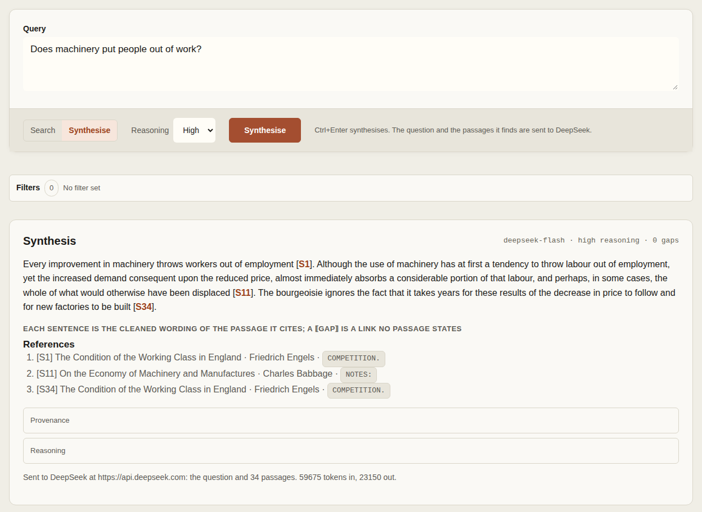
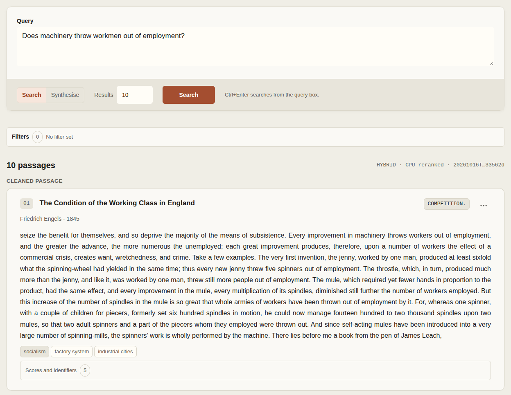
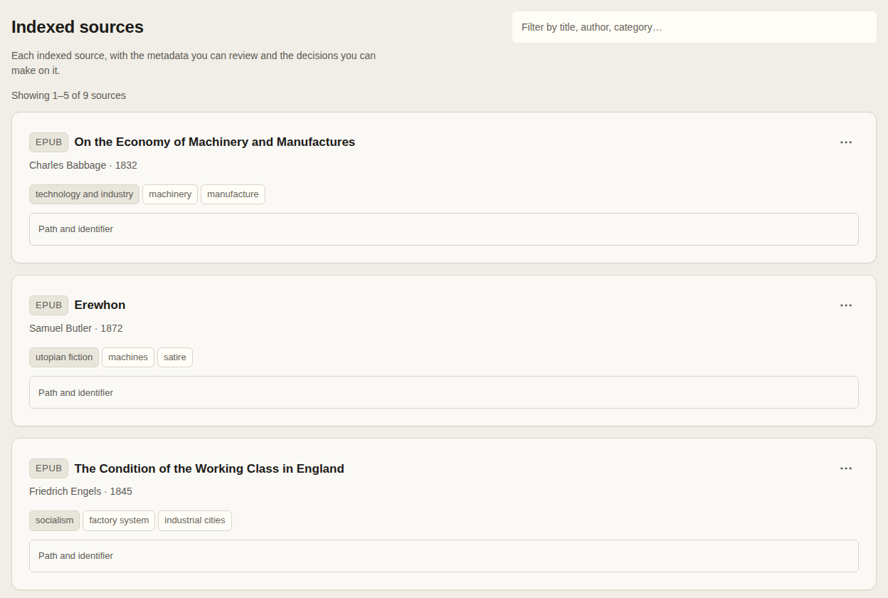
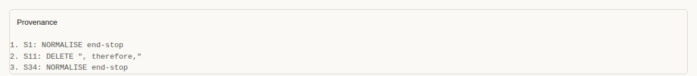
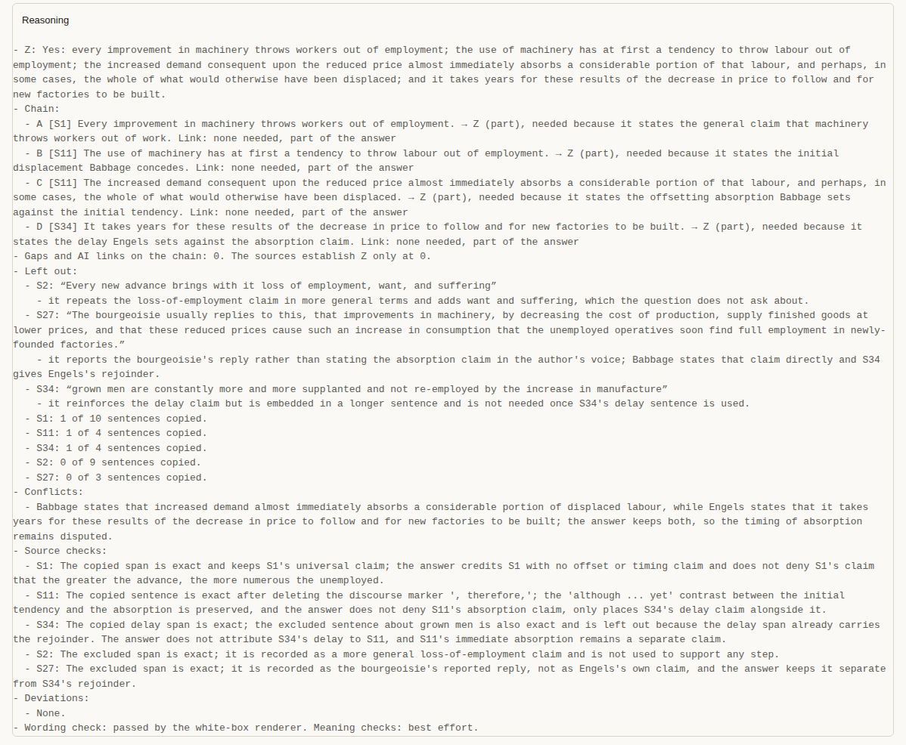
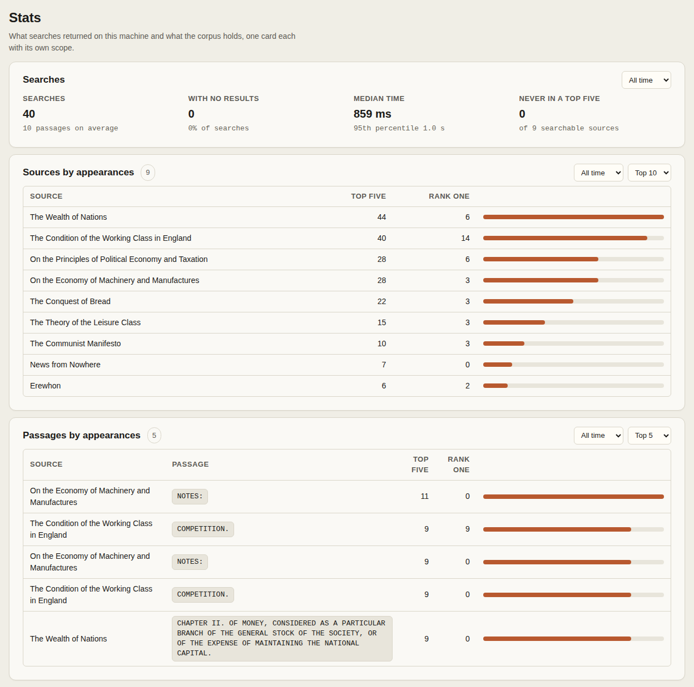
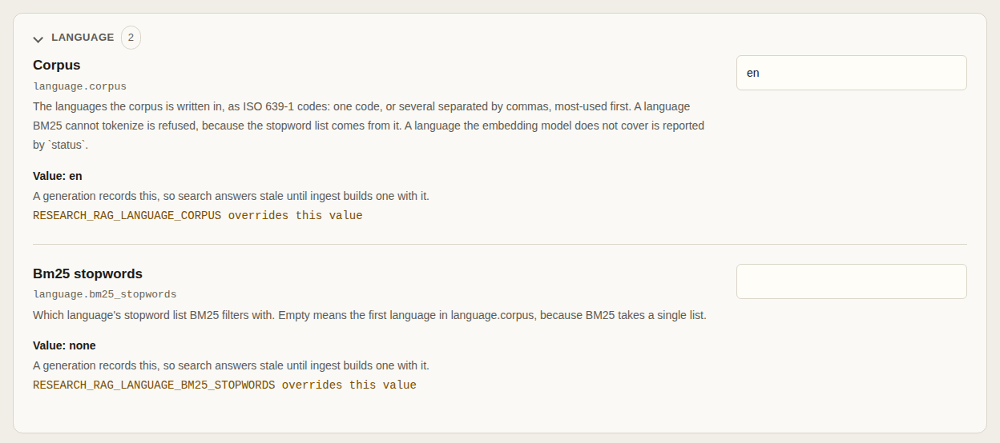
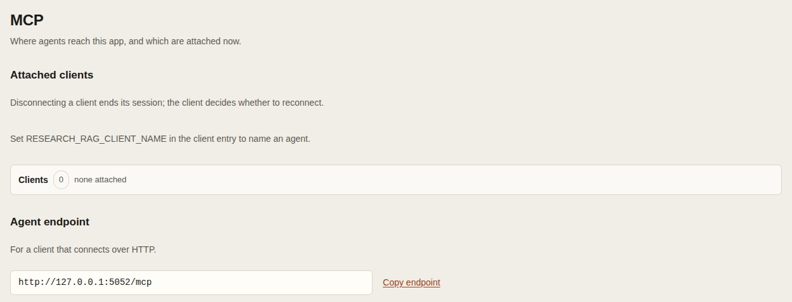

# research-rag

research-rag helps you find evidence in your documents and build answers from their passages. Indexing and search run locally on CPU.

- Build a searchable corpus from a project's PDFs, EPUBs, and MOBIs.
- Find passages through combined lexical and semantic search.
- Build an answer with [white-box synthesis](https://github.com/AhmedKishki/agent-skills/tree/main/skills/white-box-synthesis). Check each sentence's source and the model's reasons for including it.
- Read passages with source locators, review bibliography, and exclude unwanted evidence in the browser.
- Work with the same corpus through the browser workspace, command line, or MCP-connected agents.

[Install](#install) · [Build a project](#build-a-project) · [Synthesise an answer](#synthesise-an-answer) · [Check the answer](#check-the-answer) · [Open the workspace](#open-the-workspace) · [Search statistics](#search-statistics) · [Connect an agent](#connect-an-agent) · [Features and limits](FEATURES.md)



Screenshots show a demo project of nine public-domain books.

## Requirements

- Linux, Python 3.11 or 3.12, [uv](https://docs.astral.sh/uv/), and Git.
- Internet access for initial model and tokenizer downloads. Cached installations can use `--offline`.
- A DeepSeek API key, only for `synthesise`.
- A systemd user session for PDF conversion.

## Install

- Install the command:

```bash
uv tool install git+https://github.com/AhmedKishki/research-rag.git
```

- For development, clone the repository and install its command:

```bash
git clone https://github.com/AhmedKishki/research-rag.git
cd research-rag
uv sync --frozen
uv run research-rag install
```

## Build a project

- Choose a project directory and initialize it:

```bash
research-rag --project-root "/path/to/project" init --name "My project"
```

- Copy PDFs, EPUBs, and MOBIs into the project's `sources/` directory, then build the index:

```bash
research-rag --project-root "/path/to/project" ingest
```

- The first build can take time. Repeat `ingest` if it reports an unfinished build.
- Run `research-rag --project-root "/path/to/project" doctor --prefetch-models` online to prepare models and PDF conversion tools for an offline build.
- Later builds reuse compatible extracted text and vectors. Use `ingest --force-recompute` to reprocess sources.
- If a source cannot be extracted, a validated generation containing the remaining sources is retained as **partial**, not selected. Review the omitted sources in the result or generation list. Repair them and run `ingest` again, or select the partial generation with `research-rag --project-root "/path/to/project" generations --use GENERATION_ID`.

## Read the evidence

```bash
research-rag --project-root "/path/to/project" search "How is evidence interpreted?" --top-k 5
```

- Search combines lexical and semantic retrieval with reranking.
- Passages contain cleaned source text. Check the original at the locator before quoting.



In the [workspace](#open-the-workspace), open **Sources** to review titles, authors, years, and tags. Each source's menu lets you edit its metadata or exclude it from search without changing the original.



## Synthesise an answer

Synthesis sends your question, the system prompt, and every passage retrieved during the run to DeepSeek. It uses your API credit.

```bash
research-rag api-key set
research-rag --project-root "/path/to/project" synthesise "How is evidence interpreted?" --verbose
```

- `api-key set` asks for a DeepSeek API key without displaying it, and keeps it for this account.
- DeepSeek finds passages and submits a plan for assembling the answer. The app builds each sentence from their wording.
- Each sentence cites its passage, such as `[S1]`. When no retrieved passage supplies a needed connection, the answer marks it as `⟦GAP⟧`.
- `--reasoning low|high|max` selects DeepSeek's reasoning level. The default is `high` unless the `synthesis.reasoning` setting overrides it.
- In the [workspace](#open-the-workspace), switch the search box from **Search** to **Synthesise** and choose a reasoning level.
- The result names the endpoint and reports how many passages were sent.

### Check the answer

Open **Provenance** below the answer to see which passage each sentence uses and what edits were made. Here the record shows punctuation changes and one deleted phrase.



Open **Reasoning** to read why those passages were chosen, what was left out, and where the sources disagree. The source checks are the model's own; you judge whether the passages support the answer.



Use `--verbose` in the CLI, or `verbose: true` through MCP, to read both records.

## Open the workspace

```bash
research-rag --project-root "/path/to/project" --start-ui start
```

- Omit `--project-root` and `--project` to choose a registered project in the terminal. Use Up/Down and Enter; Escape or Ctrl-C cancels. This also applies to a bare `research-rag` invocation.
- Each browser workspace stays within its project. Start another project from a separate terminal and open its own web address.
- Keep the terminal open. Ctrl-C or closing it stops the app.
- An app another terminal or an agent started cannot be stopped from yours. A bare call offers to take it over, restarting it in your terminal on the same port; `--take-over` skips the question.
- The workspace defaults to local-only access.

### Use a phone on home Wi-Fi

```bash
research-rag --start-ui start --lan
```

- Open **Remote Access** on the laptop website. Scan its locally generated QR code with your phone or open the displayed URL.
- Open `/next/` for the phone workspace or `/` for the desktop workspace. Both use the same project.
- LAN mode uses HTTP without a login. Devices able to reach the port on the private network can read this project's sources and perform enabled workspace actions. Traffic is unencrypted. Use only a trusted home network; never forward this port to the internet.
- LAN access supports the laptop's detected private IPv4 addresses. Allow the displayed port through the laptop firewall for your home network. Guest Wi-Fi or client isolation can prevent access.
- Keep the laptop awake and its serving terminal open. If the laptop's network address changes, disable and enable LAN access on the laptop's Remote Access page and scan the new code.
- MCP, CLI control, installation management, and the local project/client registry remain local-only. The laptop's Remote Access page enables or disables phone access immediately without restarting. `research-rag lan enable` and `research-rag lan disable` provide the same control in a terminal. The choice lasts only for this app run; starting without `--lan` returns to loopback-only serving.

### Search statistics

The **Stats** view shows search totals, response times, and how often each source and passage appeared in the top five or ranked first. Filter by time range and choose how many entries to show. The figures below describe demo activity, not a performance benchmark.



### Settings

The **Config** view shows current values, environment overrides, and whether a change needs a new generation.



## Connect an agent

- Start the app, then copy a client entry from the **MCP** view or print it:

```bash
research-rag --project-root "/path/to/project" doctor --mcp-entry
```

- HTTP clients use the app's `/mcp` endpoint. stdio clients use `research-rag mcp --project-name "My project"`.
  - The stdio bridge connects to the running app by its registered project name.



## Updates

- The browser's **Updates** view shows GitHub release notes. **Not now** declines without changing the installation.
- `research-rag update` in a terminal shows the changelog and asks for approval. Installation needs explicit approval. `research-rag update --help` covers unattended updates and offline checks.

## Help and details

- `research-rag --help` or `research-rag help`: the command reference, without a project.
- `research-rag COMMAND --help`: arguments and examples for one command.
- `research-rag help TOPIC`: workflow guidance for `agents`, `filters`, `settings`, or `synthesis`.
- Extraction is text only. A PDF with a text layer is indexed as that text; a PDF with no text layer or a password is refused.
  - Scanned PDFs need OCR performed outside this app. Add the recognised copy to the sources directory and run `ingest`.
  - PDF cleaning repairs recoverable text and marks gaps where text is lost. Extraction and text-quality checks are described in [Features and limits](FEATURES.md).
- MOBI support covers unencrypted reflowable books, not dictionaries or Print Replica. [Features and limits](FEATURES.md) specifies supported variants and parser safety limits.
- [Storage and portability](STORAGE.md), [measurement protocols](MEASUREMENTS.md).

## UltraRAG credit and licensing

- Derived from [UltraRAG](https://github.com/OpenBMB/UltraRAG)'s MCP architecture, corpus chunker, and BM25 retriever.
  - UltraRAG credits THUNLP at Tsinghua University, NEUIR at Northeastern University, OpenBMB, AI9stars, and its contributors.
- This is an independent project, not an official UltraRAG release, and is not affiliated with or endorsed by those organizations or contributors.
- This repository's code uses the [Apache License 2.0](LICENSE). Extraction dependencies carry separate AGPL and GPL obligations. [NOTICE](NOTICE) records their terms, model licences, and upstream revisions.
